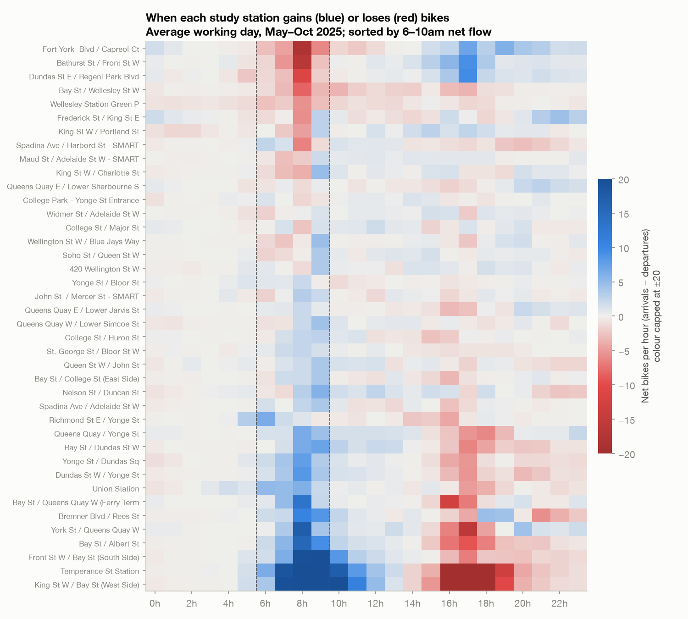
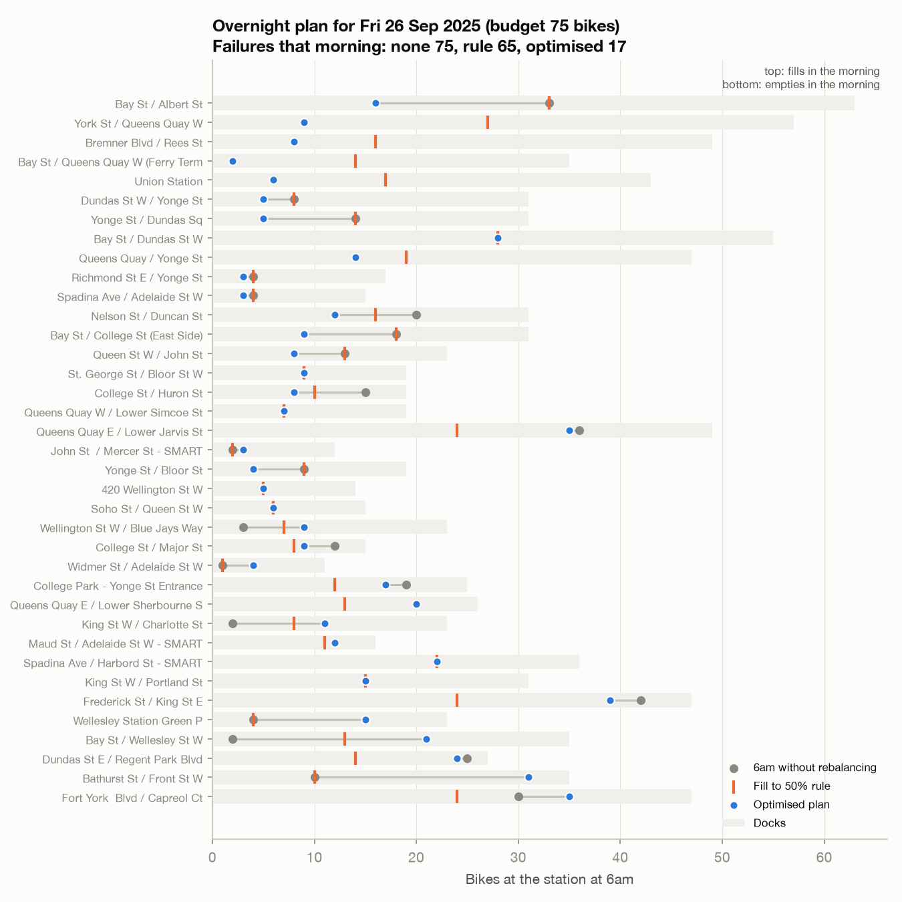
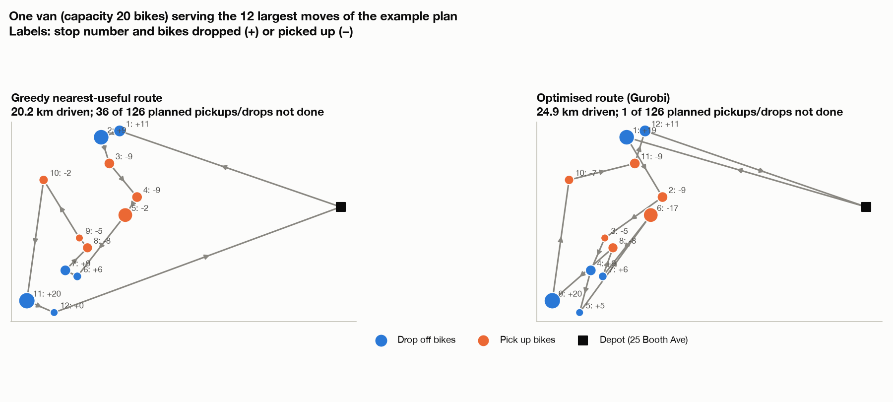

# Toronto Bike Share: Overnight Rebalancing with Optimization

> **Status:** complete through Phase 3 (data → analysis → optimization →
> evaluation). Every number below is reproduced by `./run_all.sh`.

## The problem in one paragraph

Each weekday morning, commuters empty some downtown Bike Share stations and fill
others. Riders then find no bike to take, or no dock to return to. This project
uses a year of public trip data to measure that imbalance. It then builds two
Gurobi models: one decides how many bikes each station should hold at the start
of the morning, and one routes a van to move them. The result is compared with
doing nothing and with a simple rule of thumb.

## Headline results

The test set is 43 held-out working-day mornings in Sep–Oct 2025, at the 37
downtown stations that overnight repositioning can help:

| Overnight policy | Bikes moved per night | Failed pickups + returns, 6–10am |
|---|---|---|
| No rebalancing | 0 | **73.7** per morning (3.9% of station visits) |
| Rule of thumb: fill every station to 50% | 73 | **82.1** (11% *worse* than doing nothing) |
| **Optimised plan (Gurobi MIP)** | 75 | **27.8 (−62%)** |

- **The optimised plan beat no rebalancing on all 43 test mornings.**
- **75 bikes per night is about four loads for a 20-bike van.** Beyond 75–100
  bikes, extra moves stop helping.
- **The intuitive rule backfires.** Residential edge stations need to start
  nearly full and the office core nearly empty. Evening everything out to 50%
  moves bikes the wrong way.
- **Sequencing matters once the van is full.** For one example night, an
  optimised van route completes 125 of 126 planned pickups and drops in 24.9 km.
  A greedy "nearest useful station" route drives 20.2 km but leaves 36 undone.
- Failure counts are lower bounds; see [Limitations](#limitations).

## Data

| Source | What it gives | Link |
|---|---|---|
| City of Toronto Open Data | Every trip: start/end station, start/end time, user type | [Bike Share Toronto Ridership Data](https://open.toronto.ca/dataset/bike-share-toronto-ridership-data/) |
| Bike Share Toronto GBFS feed | Station location and dock capacity | [station_information](https://tor.publicbikesystem.net/ube/gbfs/v1/en/station_information) |
| City of Toronto Open Data | 158 neighbourhood boundaries, used to define "downtown" | [Neighbourhoods](https://open.toronto.ca/dataset/neighbourhoods/) |

**Year used: 2025**, the most recent full year on the portal (checked Nov 2026).
7.81 million raw trips; 7.79 million after cleaning.

### Study stations

Downtown means 13 City neighbourhoods that together approximate the Downtown Plan
area: Bathurst St to the Don River, and Lake Ontario to Bloor St. The City does
not publish the Plan boundary itself as open data. From the downtown stations
that still exist and had 2025 trips, the 40 with the most May–Oct weekday trip
starts plus ends were selected. Together they account for **18.7%** of those
trip ends across the whole system.
List: [outputs/tables/study_stations.csv](outputs/tables/study_stations.csv).


### Data issues found

Each issue is handled in [src/clean.py](src/clean.py) and counted in
[outputs/tables/data_issues.csv](outputs/tables/data_issues.csv).

| Issue | Size | Handling |
|---|---|---|
| **End station names are wrong for Jan–Oct.** `End_Station_Name` is a copy of `Start_Station_Name` on 100% of rows, even when the end station ID differs. Nov–Dec are correct. | 10 of 12 files | Names ignored; stations are joined by ID only. The end IDs were checked: the implied straight-line riding speed has a median of 9–10 km/h in every month, including the correct Nov–Dec files. Wrong IDs would make this erratic. |
| Mixed file encodings: Jan–Oct are Windows-1252, Nov–Dec are UTF-8 | 10 of 12 files | Read as UTF-8, falling back to Windows-1252 |
| Missing end station or end time (bike not returned to a dock) | 6,957 trips (0.09%) | Dropped |
| Trips under 60 seconds (false starts, immediate re-docks) | 16,889 (0.22%) | Dropped |
| Trips over 24 hours | 12 | Dropped |
| `Trip_Duration` disagrees with the timestamps by more than 60 s | 265 | Duration recomputed from timestamps |
| **The station list is a current snapshot (Nov 2026), not 2025.** 64 station IDs used in 2025 are not in it. | 785,885 trips (10.1%) touch one | Trips kept and flagged. These stations have no coordinates or capacity, so they cannot be study stations. |
| ↳ Toronto Island stations are seasonal, so they are absent from a winter snapshot | e.g. Centre Island Ferry Dock | Excluded by rule in any case: ferry access only, so no overnight vans |
| ↳ Downtown stations removed after 2025. 7047 University Ave / Gerrard St W would have ranked about 8th. 7004 University Ave / Elm St, two blocks away, appears in the feed with no 2025 trips and may have replaced it (not confirmed). | 1 station that would have made the top 40 | Excluded; the study set is limited to stations that exist today |
| Downtown stations with no 2025 trips (opened later) | 20 | Excluded: no history to model |
| Dock capacity comes from the 2026 feed and may differ from 2025 | unknown | Accepted as a limitation |

## Approach

1. **Data:** download, clean, and join trips to stations by station ID.
2. **Exploratory analysis:** when and where trips happen, and which stations
   empty out or fill up during the morning and evening peaks.
3. **Optimization:**
   - *Overnight repositioning (MIP):* choose each station's starting inventory
     to minimise expected morning failures, given a budget of bikes moved.
   - *Van routing (MIP):* for one cluster, the stop order and loads for a
     capacitated van.
4. **Evaluation:** replay held-out weekday mornings under three policies:
   no rebalancing, a fill-to-50% rule, and the optimised plan.

The full plan, with the formulations in mathematical notation, is in
[docs/PLAN.md](docs/PLAN.md). How Bike Share Toronto rebalances today, and how
this model relates to it, is in [docs/CURRENT_PRACTICE.md](docs/CURRENT_PRACTICE.md).

## Key findings from the data

All figures are for 2025. "Working days" means Monday–Friday excluding the five
statutory holidays in May–Oct; the data confirms holidays behave like weekends
(2.8% of holiday trips start 7–9am, vs 3.7% on weekends and 11.8% on working days).
Script: [src/eda.py](src/eda.py). Per-station numbers:
[outputs/tables/station_morning_profile.csv](outputs/tables/station_morning_profile.csv).

**1. Demand is seasonal: May–October carries 76.5% of the year's 7.79M trips.**
July peaks at 1.19M. That is why the study uses May–Oct.


**2. Working days and weekends have similar volume but a different shape.**
Both average about 32,000 trips a day. Working days have sharp commuter peaks
at 8am and 5pm; weekends have one broad afternoon hump. Members (annual pass
holders) make 83% of 6–10am working-day trips, compared with 73% of all trips.
Commuters repeat the same journeys, so the morning pattern recurs day after day.
That makes a fixed overnight plan reasonable, and it confirms 6–10am as the
window to protect.


**3. The study stations are the busiest in the system.** 16 of the 20 busiest
stations are study stations. The other four are seasonal Toronto Island
stations, a station removed after 2025, and one station just west of the
downtown boundary.


**4. In the morning, the downtown edges empty and the core fills, and this
reverses in the evening.** On an average working morning, 10 study stations
lose bikes and 24 gain them. The biggest losers are residential edges: Fort
York/CityPlace (−32 bikes), Bathurst/Front (−26), Regent Park (−17) and
Bay/Wellesley (−16). The biggest gainers are offices and transit: Bay/Albert (+32),
York/Queens Quay (+25) and Union Station (+18). Morning and evening net flows
are strongly negatively correlated (−0.76, excluding the two extreme stations
below).




**5. The imbalance is consistent enough to plan for, and overnight
repositioning can absorb it at 37 of the 40 stations.** For the strongly
imbalanced stations, the direction of the morning flow is the same on almost
every day (the 10th–90th percentile range stays on one side of zero). For 37
stations, the morning swing fits within dock capacity on more than 90% of
mornings. So a suitable 6am starting level can prevent failures. For example,
Fort York needs about 34 of its 47 docks filled on a typical morning.

**6. Three stations cannot be fixed overnight: King St W / Bay St, Temperance St
and Front St W / Bay St.** They gain 255, 175 and 56 bikes per morning, against
39, 55 and 19 docks. The recorded trips there could only have ended at those
stations if bikes were being cleared throughout the morning, which looks like
the operator's valet service or daytime vans. The station feed does not mark them
as valet stations, but it is a winter snapshot. These are daytime or valet
stations, not overnight ones.


**What this means for the optimization**

- Model the 37 stations that overnight repositioning can help. Report the three
  valet-type stations separately instead of letting them dominate the objective.
- Starting levels must be uneven: near-full at the residential edges and
  near-empty in the core. A uniform rule such as "fill everything to 50%" should
  do poorly. Phase 3 tests this directly.

## Optimization results

Scripts: [src/morning.py](src/morning.py) (replay and failure curves),
[src/rebalance.py](src/rebalance.py) (overnight plan and evaluation),
[src/routing.py](src/routing.py) (van route). The formulations are written out
in [docs/PLAN.md](docs/PLAN.md).

### Overnight repositioning

**Model.** For each station and each possible 6am level *y*, replaying the
May–Aug training mornings gives the expected failures *g(y)*. The model picks
one level per station to minimise total expected failures. Bikes can only be
moved between stations, and at most a budget *B* of bikes can be moved per
night. The model has 1,225 variables and 76 constraints, inside the free
license's 2,000 limit, and each night solves in a fraction of a second.

**Evaluation.** For each Sep–Oct test night:
1. Estimate the no-rebalancing 6am inventory.
2. Compute a plan with each policy.
3. Replay that real morning from the planned levels and count failures.

The test mornings are never used to build the plan.


| Bikes moved per night | 0 | 25 | 50 | 75 | 100 | no limit (142) |
|---|---|---|---|---|---|---|
| Optimised: failures per morning | 73.7 | 46.3 | 32.9 | 27.8 | 27.1 | 28.8 |
| 50% rule: failures per morning | 73.7 | 74.9 | 79.3 | 82.1 | 84.1 | 84.8 |

- **Diminishing returns:** the first 25 bikes remove 27 failures. The step from
  75 to 100 removes less than one. Beyond about 100 bikes the plan starts
  fitting May–Aug patterns that don't fully hold in Sep–Oct, and test failures
  rise slightly. That is why the full table is
  reported, not only the best point.
- **Empty stations are easier to fix than full ones.** At 75 bikes, failed
  pickups fall from 39.1 to 8.6 per morning, and failed returns fall from 34.6
  to 19.2. The plan is limited by the number of empty docks it can create in the
  core, because those bikes must fit somewhere else.

Full results: [rebalancing_results.csv](outputs/tables/rebalancing_results.csv),
per night: [rebalancing_by_night.csv](outputs/tables/rebalancing_by_night.csv).

**What a plan looks like.** On Friday 26 Sep 2025 (the median test night), the
plan fills the residential edges (Bathurst/Front 10 → 31 bikes, Bay/Wellesley
2 → 21) and empties the core (Bay/Albert 33 → 16). Failures that morning: 75
with no rebalancing, 65 with the 50% rule, 17 with the plan.



### Van routing for one cluster

**Model.** This is a single-van pickup-and-delivery tour from the depot at
25 Booth Ave, covering the 12 stations with the largest moves in the example
plan. Those 12 account for 126 of its 150 pickups and drops. Binary arc
variables choose the route, load variables enforce van capacity, and visit-order
constraints prevent disconnected sub-tours. Unfinished moves are penalised. The
model has 336 variables and 326 constraints and solves to proven optimality.



| Van capacity | Optimised route | Greedy nearest-useful route |
|---|---|---|
| 10 bikes | 28.5 km, 28 of 126 not done | 21.1 km, 51 not done |
| 20 bikes | 24.9 km, **1** not done | 20.2 km, **36** not done |
| 30 bikes | 20.8 km, 0 not done | 20.2 km, 10 not done |

- The greedy route is shorter because it skips work. It arrives full where
  bikes must be picked up, or empty where they must be dropped. The optimised
  route visits stations with surplus bikes before stations that need them.
- A 10-bike van cannot finish this plan in one tour even with an optimal
  route. The gap closes at 20 bikes, and at 30 bikes the route is both complete
  and short. Van size is a real lever for this operation.

Stop list for the 20-bike van:
[route_stops_Q20.csv](outputs/tables/route_stops_Q20.csv).

### What an operator could take from this

1. **Set station-specific targets from history, not a uniform fill level.**
   This is the single biggest gain, and it costs nothing but analysis.
2. **About 75 bikes per night (four 20-bike van loads) captures most of the
   benefit** for this downtown group. Effort beyond that has little value
   overnight and is better spent on daytime and valet work.
3. **Three stations need a daytime answer.** King/Bay, Temperance St and
   Front/Bay receive several times their dock count every morning, which no
   overnight plan can fix.
4. **Route with van capacity in mind.** A good plan carried out by a
   capacity-blind route loses about 30% of its moves.

## Assumptions

Every assumption is set in [src/config.py](src/config.py) and can be changed there.

| Assumption | Value | Why |
|---|---|---|
| Study subset | 40 busiest downtown stations (13 City neighbourhoods; see Data) | Must fit the free Gurobi license (≤ 2,000 variables/constraints) |
| Season | Weekdays, May–October | Peak season, when imbalance is worst |
| Protected window | Weekdays, 6–10am | Commuter peak; confirmed or revised in Phase 2 |
| Van capacity | 10, 20 and 30 bikes (20 central) | No public figure exists, so it is run as scenarios ([current practice](docs/CURRENT_PRACTICE.md)) |
| Depot | 25 Booth Ave | Operator depot used in the prior Toronto study |
| Road distance | 1.3 × straight-line distance | Standard circuity approximation; no road network used |
| No-rebalancing 6am inventory | Each station starts the previous day at 6am 50% full; that day's real trips are replayed to 6am | No inventory history is published. One day of drift is mild, so the improvement is conservative |
| Failure weights | A failed pickup and a failed return count equally | No basis to weight one above the other |
| Train / test split | Plans learn from May–Aug mornings and are scored on Sep–Oct mornings | Mirrors planning from past weeks |
| Bike conservation | The overnight plan only moves bikes between the 37 stations | No bikes added to or removed from the group |
| Depot stock | In the routing model the van may leave the depot loaded and bring bikes back | The routed 12-station subset is not balanced on its own |
| Unfinished-move penalty | 5 km-equivalent per pickup or drop not done | Makes completing the plan the priority; distance breaks ties |
| Scope | Overnight rebalancing only | The real operation runs 24/7; stations overnight moves cannot fix are flagged for daytime/valet service |

## Limitations

- **Unrecorded failures (censored demand):** trip data records only completed
  trips. A rider who finds a station empty and walks away leaves no record. A
  rider who finds dock A full and rides on to dock B appears as a normal trip
  ending at B, and the intended destination is lost. Failures are therefore
  estimated by replaying the recorded trips against a starting inventory, and
  the estimates are lower bounds, because the recorded arrivals at A already
  exclude riders who were turned away. Measuring failures directly would need
  minute-by-minute station counts, which are not published.
- **No historical inventory:** bikes per station over time are not published,
  so the overnight starting level is estimated.
- **Stations modelled independently** in the morning replay: a failed pickup at
  A does not cancel the matching return at B.
- **Daytime rebalancing is not modelled.** The real operator also moves bikes
  during the day, so "no rebalancing" is a reference point, not the actual
  2025 operation. Absolute failure counts are not a forecast of what riders
  experienced.
- **Season drift.** Plans learned on May–Aug lose a little accuracy on Sep–Oct,
  which shows up once more than about 100 bikes are moved.
- **Routing covers one van and one 12-station cluster,** sized for the free
  license. A full night with several vans would need decomposition, for example
  routing each cluster separately, or a full license.
- **Distances** are straight-line × 1.3, not road-network shortest paths.

## How to run

```bash
.venv/bin/pip install -r requirements.txt
./run_all.sh          # download → clean → EDA → optimise and evaluate → route
```

Requires a Gurobi license; the free restricted license is enough. The first run
downloads about 230 MB and takes a few minutes.

## Repository layout

```
data/raw/          downloaded files (not committed)
data/processed/    cleaned tables (not committed; regenerated by the scripts)
src/               pipeline scripts; config.py holds paths and assumptions
outputs/figures/   charts (committed)
outputs/tables/    result tables (committed)
docs/PLAN.md       questions, formulations, evaluation design
```
