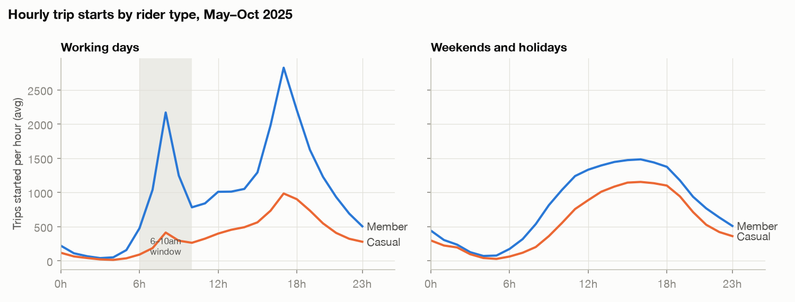
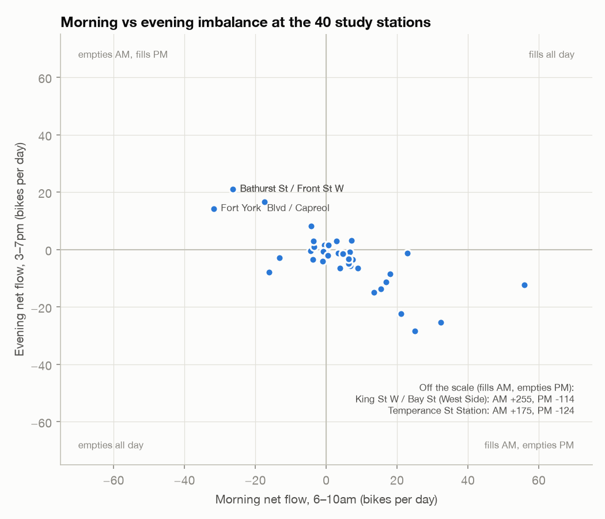
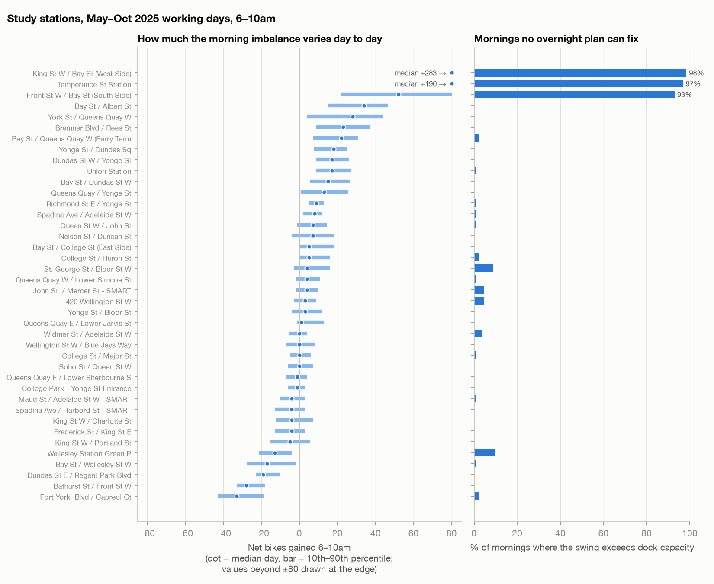

# Toronto Bike Share: Overnight Rebalancing with Optimization

> **Status:** Phases 1 (data) and 2 (exploratory analysis) complete. Results
> sections are placeholders until the optimization phase is finished.

## The problem in one paragraph

Each weekday morning, commuters empty some downtown Bike Share stations and fill
others. Riders then find no bike to take, or no dock to return to. This project
uses a year of public trip data to measure that imbalance. It then builds two
Gurobi models: one decides how many bikes each station should hold at the start
of the morning, and one routes a van to move them. The result is compared with
doing nothing and with a simple rule of thumb.

## Headline results

_To be added in Phase 3: morning failures avoided against bikes moved, on
held-out days._

## Data

| Source | What it gives | Link |
|---|---|---|
| City of Toronto Open Data | Every trip: start/end station, start/end time, user type | [Bike Share Toronto Ridership Data](https://open.toronto.ca/dataset/bike-share-toronto-ridership-data/) |
| Bike Share Toronto GBFS feed | Station location and dock capacity | [station_information](https://tor.publicbikesystem.net/ube/gbfs/v1/en/station_information) |
| City of Toronto Open Data | 158 neighbourhood boundaries, used to define "downtown" | [Neighbourhoods](https://open.toronto.ca/dataset/neighbourhoods/) |

**Year used: 2025**, the most recent full year on the portal (checked Nov 2026).
7.81 million raw trips; 7.79 million after cleaning.

### Study stations

Downtown means 13 City neighbourhoods that together approximate the Downtown Plan
area: Bathurst St to the Don River, and Lake Ontario to Bloor St. The City does
not publish the Plan boundary itself as open data. From the downtown stations
that still exist and had 2025 trips, the 40 with the most May–Oct weekday trip
starts plus ends were selected. Together they account for **18.7%** of those
trip ends across the whole system.
List: [outputs/tables/study_stations.csv](outputs/tables/study_stations.csv).


### Data issues found

Each issue is handled in [src/clean.py](src/clean.py) and counted in
[outputs/tables/data_issues.csv](outputs/tables/data_issues.csv).

| Issue | Size | Handling |
|---|---|---|
| **End station names are wrong for Jan–Oct.** `End_Station_Name` is a copy of `Start_Station_Name` on 100% of rows, even when the end station ID differs. Nov–Dec are correct. | 10 of 12 files | Names ignored; stations are joined by ID only. The end IDs were checked: the implied straight-line riding speed has a median of 9–10 km/h in every month, including the correct Nov–Dec files. Wrong IDs would make this erratic. |
| Mixed file encodings: Jan–Oct are Windows-1252, Nov–Dec are UTF-8 | 10 of 12 files | Read as UTF-8, falling back to Windows-1252 |
| Missing end station or end time (bike not returned to a dock) | 6,957 trips (0.09%) | Dropped |
| Trips under 60 seconds (false starts, immediate re-docks) | 16,889 (0.22%) | Dropped |
| Trips over 24 hours | 12 | Dropped |
| `Trip_Duration` disagrees with the timestamps by more than 60 s | 265 | Duration recomputed from timestamps |
| **The station list is a current snapshot (Nov 2026), not 2025.** 64 station IDs used in 2025 are not in it. | 785,885 trips (10.1%) touch one | Trips kept and flagged. These stations have no coordinates or capacity, so they cannot be study stations. |
| ↳ Toronto Island stations are seasonal, so they are absent from a winter snapshot | e.g. Centre Island Ferry Dock | Excluded by rule in any case: ferry access only, so no overnight vans |
| ↳ Downtown stations removed after 2025. 7047 University Ave / Gerrard St W would have ranked about 8th. 7004 University Ave / Elm St, two blocks away, appears in the feed with no 2025 trips and may have replaced it (not confirmed). | 1 station that would have made the top 40 | Excluded; the study set is limited to stations that exist today |
| Downtown stations with no 2025 trips (opened later) | 20 | Excluded: no history to model |
| Dock capacity comes from the 2026 feed and may differ from 2025 | unknown | Accepted as a limitation |

## Approach

1. **Data:** download, clean, and join trips to stations by station ID.
2. **Exploratory analysis:** when and where trips happen, and which stations
   empty out or fill up during the morning and evening peaks.
3. **Optimization:**
   - *Overnight repositioning (MIP):* choose each station's starting inventory
     to minimise expected morning failures, given a budget of bikes moved.
   - *Van routing (MIP):* for one cluster, the stop order and loads for a
     capacitated van.
4. **Evaluation:** replay held-out weekday mornings under three policies:
   no rebalancing, a fill-to-50% rule, and the optimised plan.

The full plan, with the formulations in mathematical notation, is in
[docs/PLAN.md](docs/PLAN.md). How Bike Share Toronto rebalances today, and how
this model relates to it, is in [docs/CURRENT_PRACTICE.md](docs/CURRENT_PRACTICE.md).

## Key findings from the data

All figures are for 2025. "Working days" means Monday–Friday excluding the five
statutory holidays in May–Oct; the data confirms holidays behave like weekends
(2.8% of holiday trips start 7–9am, vs 3.7% on weekends and 11.8% on working days).
Script: [src/eda.py](src/eda.py). Per-station numbers:
[outputs/tables/station_morning_profile.csv](outputs/tables/station_morning_profile.csv).

**1. Demand is seasonal: May–October carries 76.5% of the year's 7.79M trips.**
July peaks at 1.19M. That is why the study uses May–Oct.


**2. Working days and weekends have similar volume but a different shape.**
Both average about 32,000 trips a day. Working days have sharp commuter peaks
at 8am and 5pm; weekends have one broad afternoon hump. Members (annual pass
holders) make 83% of 6–10am working-day trips, compared with 73% of all trips.
Commuters repeat the same journeys, so the morning pattern recurs day after day.
That makes a fixed overnight plan reasonable, and it confirms 6–10am as the
window to protect.



**3. The study stations are the busiest in the system.** 16 of the 20 busiest
stations are study stations. The other four are seasonal Toronto Island
stations, a station removed after 2025, and one station just west of the
downtown boundary.


**4. In the morning, the downtown edges empty and the core fills, and this
reverses in the evening.** On an average working morning, 10 study stations
lose bikes and 24 gain them. The biggest losers are residential edges: Fort
York/CityPlace (−32 bikes), Bathurst/Front (−26), Regent Park (−17) and
Bay/Wellesley (−16). The biggest gainers are offices and transit: Bay/Albert (+32),
York/Queens Quay (+25) and Union Station (+18). Morning and evening net flows
are strongly negatively correlated (−0.76, excluding the two extreme stations
below).




**5. The imbalance is consistent enough to plan for, and overnight
repositioning can absorb it at 37 of the 40 stations.** For the strongly
imbalanced stations, the direction of the morning flow is the same on almost
every day (the 10th–90th percentile range stays on one side of zero). For 37
stations, the morning swing fits within dock capacity on more than 90% of
mornings. So a suitable 6am starting level can prevent failures. For example,
Fort York needs about 34 of its 47 docks filled on a typical morning.

**6. Three stations cannot be fixed overnight: King St W / Bay St, Temperance St
and Front St W / Bay St.** They gain 255, 175 and 56 bikes per morning, against
39, 55 and 19 docks. The recorded trips there could only have ended at those
stations if bikes were being cleared throughout the morning, which looks like
the operator's valet service or daytime vans. The station feed does not mark them
as valet stations, but it is a winter snapshot. These are daytime or valet
stations, not overnight ones.



**What this means for the optimization**

- Model the 37 stations that overnight repositioning can help. Report the three
  valet-type stations separately instead of letting them dominate the objective.
- Starting levels must be uneven: near-full at the residential edges and
  near-empty in the core. A uniform rule such as "fill everything to 50%" should
  do poorly. Phase 3 tests this directly.

## Assumptions

Every assumption is set in [src/config.py](src/config.py) and can be changed there.

| Assumption | Value | Why |
|---|---|---|
| Study subset | 40 busiest downtown stations (13 City neighbourhoods; see Data) | Must fit the free Gurobi license (≤ 2,000 variables/constraints) |
| Season | Weekdays, May–October | Peak season, when imbalance is worst |
| Protected window | Weekdays, 6–10am | Commuter peak; confirmed or revised in Phase 2 |
| Van capacity | 10, 20 and 30 bikes (20 central) | No public figure exists, so it is run as scenarios ([current practice](docs/CURRENT_PRACTICE.md)) |
| Depot | 25 Booth Ave | Operator depot used in the prior Toronto study |
| Road distance | 1.3 × straight-line distance | Standard circuity approximation; no road network used |
| Overnight starting inventory | Simulated from the previous day's trips | No inventory history is published; see [PLAN.md](docs/PLAN.md) |
| Scope | Overnight rebalancing only | The real operation runs 24/7; stations overnight moves cannot fix are flagged for daytime/valet service |

## Limitations

- **Unrecorded failures (censored demand):** trip data records only completed
  trips. A rider who finds a station empty and walks away leaves no record. A
  rider who finds dock A full and rides on to dock B appears as a normal trip
  ending at B, and the intended destination is lost. Failures are therefore
  estimated by replaying the recorded trips against a starting inventory, and
  the estimates are lower bounds, because the recorded arrivals at A already
  exclude riders who were turned away. Measuring failures directly would need
  minute-by-minute station counts, which are not published.
- **No historical inventory:** bikes per station over time are not published,
  so the overnight starting level is estimated.
- **Stations modelled independently** in the morning replay.

## How to run

```bash
.venv/bin/pip install -r requirements.txt
./run_all.sh          # download → clean (EDA and optimisation added in later phases)
```

Requires a Gurobi license; the free restricted license is enough. The first run
downloads about 230 MB and takes a few minutes.

## Repository layout

```
data/raw/          downloaded files (not committed)
data/processed/    cleaned tables (not committed; regenerated by the scripts)
src/               pipeline scripts; config.py holds paths and assumptions
outputs/figures/   charts (committed)
outputs/tables/    result tables (committed)
docs/PLAN.md       questions, formulations, evaluation design
```
