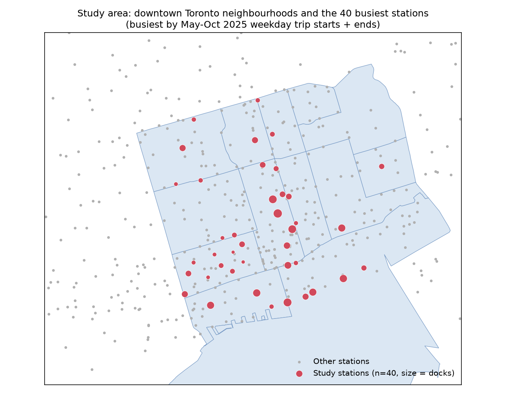
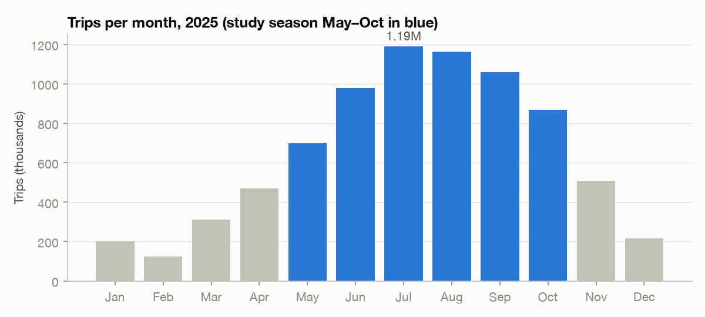
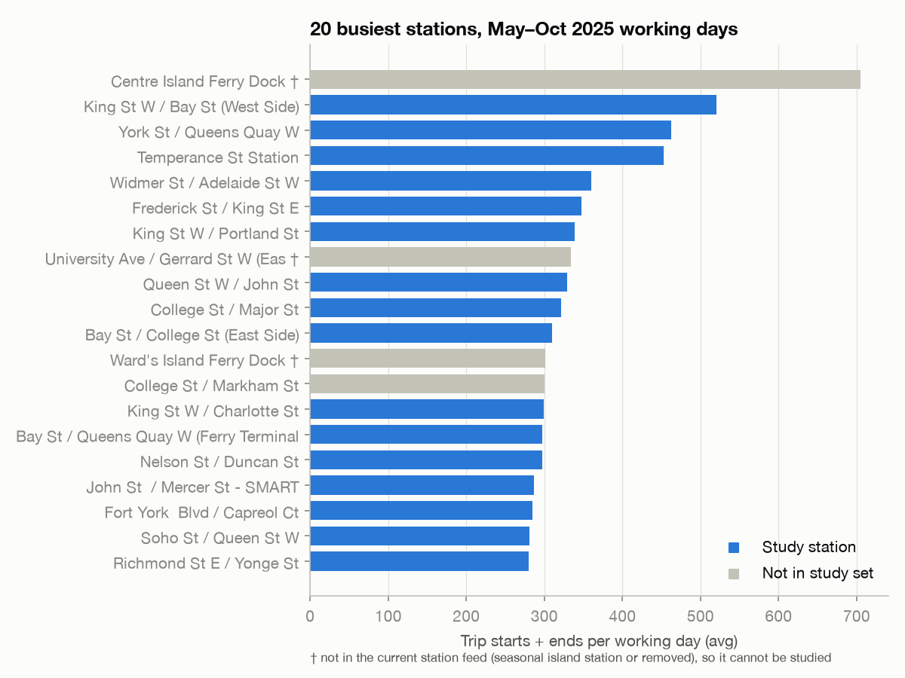
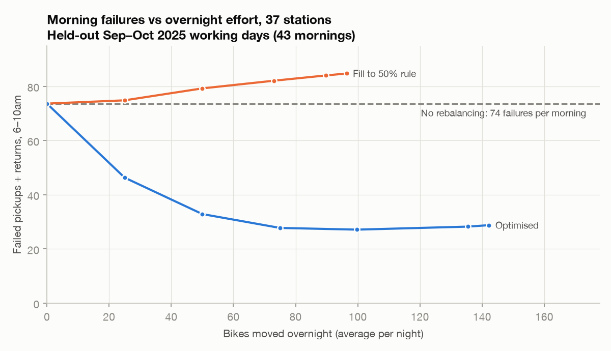
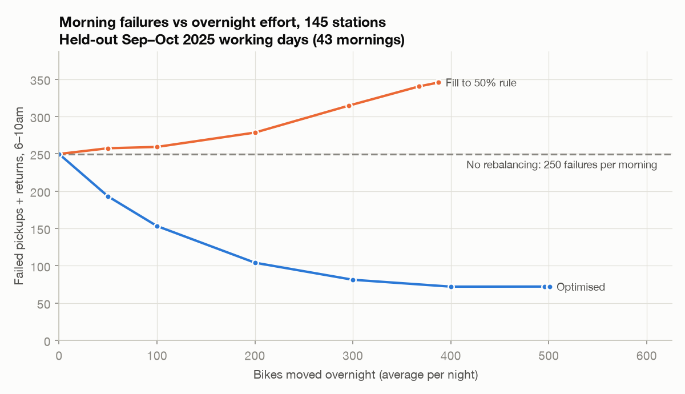
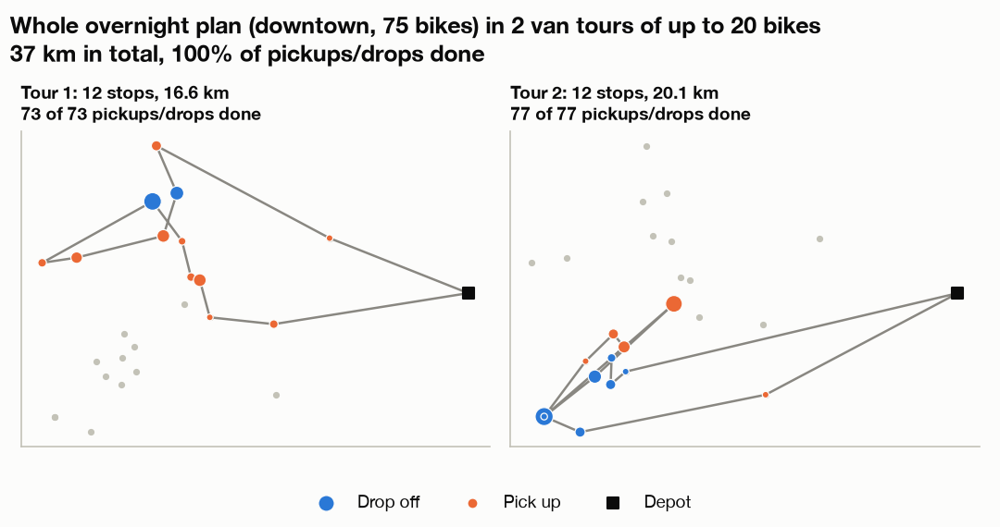
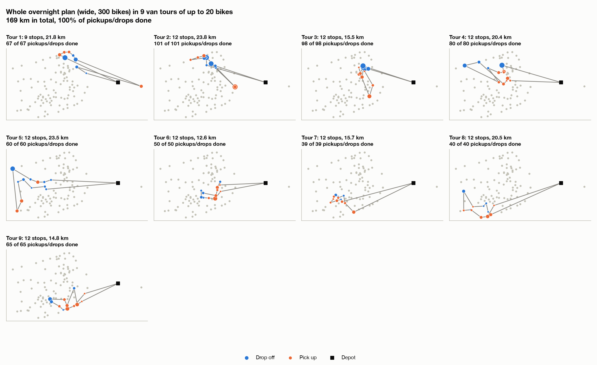
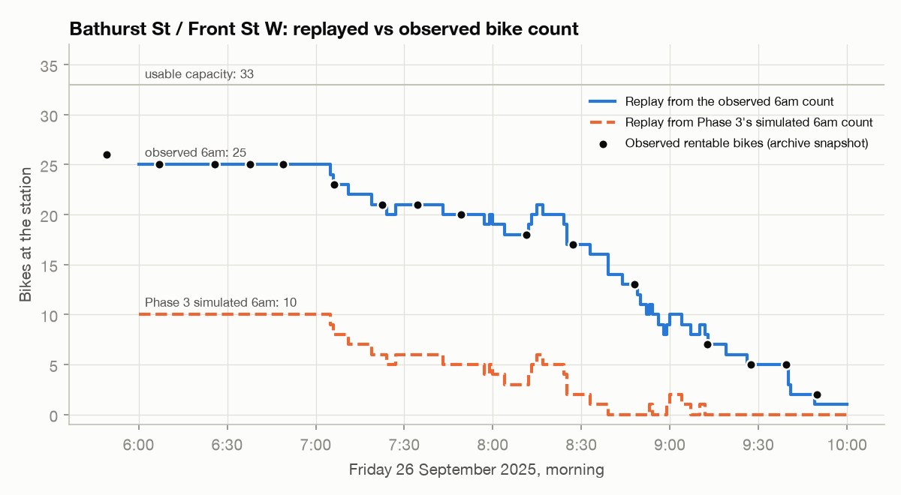
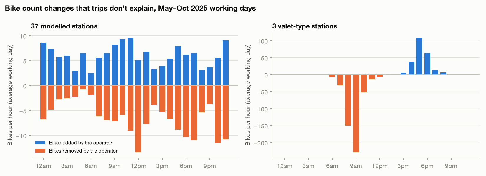

# Toronto Bike Share: Overnight Rebalancing with Optimization

> **Status:** complete through Phase 4 (data → analysis → optimization →
> evaluation → check against observed station counts). Every number below is
> reproduced by `./run_all.sh`.

## The problem in one paragraph

Each weekday morning, commuters empty some downtown Bike Share stations and fill
others. Riders then find no bike to take, or no dock to return to. This project
uses a year of public trip data to measure that imbalance. It then builds two
optimization models (mixed-integer programs, solved with the open-source HiGHS
solver and cross-checked against Gurobi): one decides how many bikes each station should hold at the start
of the morning, and one routes a van to move them. The result is compared with
doing nothing, with a simple rule of thumb and, using station counts observed
in 2025, with what the operator actually did.

## Headline results

The test set is 43 held-out working-day mornings in Sep–Oct 2025, at the 37
downtown stations that overnight repositioning can help. Each night starts from
the station counts actually observed in 2025
([Phase 4](#checked-against-observed-station-counts)), and every policy is
replayed against the same real 6–10am trips:

| Overnight policy (9pm–6am) | Bikes moved per night | Failed pickups + returns, 6–10am (replayed) |
|---|---|---|
| No overnight moves | 0 | 60.3 per morning |
| **What the operator actually did** | about 31 | **37.9** |
| Optimised plan (MIP), same effort | about 31 | 37.3 |
| **Optimised plan (MIP)** | 50 | **29.7 (−22% vs the operator)** |
| Rule of thumb: fill every station to 50% | 50 | 73.8 (worse than no moves) |

- **The replay matches real station counts.** Started from the observed 6am
  count, the replayed count is within one bike of the later snapshots 89.5% of
  the time: 98.9% in the first hour, falling to 78.0% in the fourth as
  unrecorded changes such as daytime van moves build up.
- **At equal effort, the plan only ties the operator** (37.3 vs 37.9, better
  on 21 of 43 mornings). The gain comes from doing more: with 50 bikes a night
  the plan beats actual practice on 33 of 43 mornings. Beyond about 50 bikes,
  extra moves stop helping.
- **Phase 3's simulated starting state was off.** Without station counts,
  Phase 3 simulated the 6am state. It was within 3 bikes of the observed count
  on only 44% of station-mornings, and its baseline (73.7 failures) and
  improvement (−62%) were overstated. The ranking of the policies held.
- **The intuitive rule backfires.** Residential edge stations need to start
  nearly full and the office core nearly empty. Evening everything out to 50%
  moves bikes the wrong way.
- **Sequencing matters once the van is full.** For one example night, an
  optimised van route completes 125 of 126 planned pickups and drops in 24.9 km.
  A greedy "nearest useful station" route drives 20.2 km but leaves 36 undone.
- **Widening the network helps.** On the 145 busiest stations (half of all
  trip ends, a 4,062-variable model), failures fall from 249.8 to 72.0 per
  morning with 400 bikes moved (Phase 3, simulated baseline). Downtown stations themselves also do
  better than when optimised alone (best 27.2 → 24.6), because the core's
  surplus bikes have somewhere useful to go.
- **The whole night can be routed.** The downtown plan takes 2 van tours
  (37 km). The wide plan takes 9 tours (169 km, about 5.6 hours of driving).
  Every pickup and drop is done in both. Grouping stations so each tour's
  pickups and drops balance is essential: grouping by direction alone leaves up
  to 39% of moves undone.
- **The valet stations are confirmed.** At the three stations Phase 2 flagged,
  about 495 bikes a day disappear without a trip, 470 of them between 6 and
  11am, and about 238 reappear, mostly between 3 and 8pm.
- Failure counts are replayed: a likely undercount, and failures avoided is an
  estimate, not a bound; see [Limitations](#limitations).

## Data

| Source | What it gives | Link |
|---|---|---|
| City of Toronto Open Data | Every trip: start/end station, start/end time, user type | [Bike Share Toronto Ridership Data](https://open.toronto.ca/dataset/bike-share-toronto-ridership-data/) |
| Bike Share Toronto GBFS feed | Station location and dock capacity | [station_information](https://tor.publicbikesystem.net/ube/gbfs/v1/en/station_information) |
| City of Toronto Open Data | 158 neighbourhood boundaries, used to define "downtown" | [Neighbourhoods](https://open.toronto.ca/dataset/neighbourhoods/) |
| Community archive of the GBFS `station_status` feed (Phase 4) | Rentable bikes, disabled bikes, free and disabled docks for every station, about every 16 minutes since April 2024. Collected by Max Halford; combined into one file for a University of Toronto course project. Not an official dataset | [bike-sharing-history](https://github.com/MaxHalford/bike-sharing-history), [toronto-bikeshare-data](https://github.com/ThatRandomUser23/toronto-bikeshare-data) |

**Year used: 2025**, the most recent full year on the portal (checked Nov 2026).
7.81 million raw trips; 7.79 million after cleaning.

### Study stations

Downtown means 13 City neighbourhoods that together approximate the Downtown Plan
area: Bathurst St to the Don River, and Lake Ontario to Bloor St. The City does
not publish the Plan boundary itself as open data. From the downtown stations
that still exist and had 2025 trips, the 40 with the most May–Oct weekday trip
starts plus ends were selected. Together they account for **18.7%** of those
trip ends across the whole system.
List: [outputs/tables/study_stations.csv](outputs/tables/study_stations.csv).



### Data issues found

Each issue is handled in [src/clean.py](src/clean.py) and counted in
[outputs/tables/data_issues.csv](outputs/tables/data_issues.csv).

| Issue | Size | Handling |
|---|---|---|
| **End station names are wrong for Jan–Oct.** `End_Station_Name` is a copy of `Start_Station_Name` on 100% of rows, even when the end station ID differs. Nov–Dec are correct. | 10 of 12 files | Names ignored; stations are joined by ID only. The end IDs were checked: the implied straight-line riding speed has a median of 9–10 km/h in every month, including the correct Nov–Dec files. Wrong IDs would make this erratic. |
| Mixed file encodings: Jan–Oct are Windows-1252, Nov–Dec are UTF-8 | 10 of 12 files | Read as UTF-8, falling back to Windows-1252 |
| Missing end station or end time (bike not returned to a dock) | 6,957 trips (0.09%) | Dropped |
| Trips under 60 seconds (false starts, immediate re-docks) | 16,889 (0.22%) | Dropped |
| Trips over 24 hours | 12 | Dropped |
| `Trip_Duration` disagrees with the timestamps by more than 60 s | 265 | Duration recomputed from timestamps |
| **The station list is a current snapshot (Nov 2026), not 2025.** 64 station IDs used in 2025 are not in it. | 785,885 trips (10.1%) touch one | Trips kept and flagged. These stations have no coordinates or capacity, so they cannot be study stations. |
| ↳ Toronto Island stations are seasonal, so they are absent from a winter snapshot | e.g. Centre Island Ferry Dock | Excluded by rule in any case: ferry access only, so no overnight vans |
| ↳ Downtown stations removed after 2025. 7047 University Ave / Gerrard St W would have ranked about 8th. 7004 University Ave / Elm St, two blocks away, appears in the feed with no 2025 trips and may have replaced it (not confirmed). | 1 station that would have made the top 40 | Excluded; the study set is limited to stations that exist today |
| Downtown stations with no 2025 trips (opened later) | 20 | Excluded: no history to model |
| Dock capacity comes from the 2026 feed and differs from 2025 | 16 of the 37 modelled stations differ at some point in the 2025 archive, e.g. Union Station had 24–27 docks (43 in 2026) and Queens Quay E / Lower Jarvis St 22–23 (49). 1,074 docks at the end of the 2025 season vs 1,114 | Phase 3 uses the 2026 feed; Phase 4 uses the counts observed in 2025 ([observed_docks_2025.csv](outputs/tables/observed_docks_2025.csv)) |
| Station-count archive (Phase 4) has gaps | No snapshots 16–28 July 2025; about every 40 minutes from 7 to 11pm | Phase 4 uses mornings with a snapshot within 15 minutes of 6am and no gap over 35 minutes before 10am: 65 of 84 training and all 43 test mornings |
| Archive docks don't add up | On 25.7% of station snapshots, docks exceed rentable + disabled bikes + free + disabled docks, usually by 1–2 | Phase 4 uses usable capacity = rentable bikes + free docks |

## Approach

1. **Data:** download, clean, and join trips to stations by station ID.
2. **Exploratory analysis:** when and where trips happen, and which stations
   empty out or fill up during the morning and evening peaks.
3. **Optimization:**
   - *Overnight repositioning (MIP):* choose each station's starting inventory
     to minimise expected morning failures, given a budget of bikes moved.
   - *Van routing (MIP):* for one cluster, the stop order and loads for a
     capacitated van.
   - *Whole-night routing:* split the plan into balanced van tours, then
     route each one.
   - *Wider network:* the same model on the 145 busiest stations.
4. **Evaluation:** replay held-out weekday mornings under three policies:
   no rebalancing, a fill-to-50% rule, and the optimised plan.
5. **Check against observed station counts (Phase 4):** validate the replay,
   start every policy from the real 2025 state, and add what the operator
   actually did as a fourth policy.

The full plan, with the formulations in mathematical notation, is in
[docs/PLAN.md](docs/PLAN.md). How Bike Share Toronto rebalances today, and how
this model relates to it, is in [docs/CURRENT_PRACTICE.md](docs/CURRENT_PRACTICE.md).

## Key findings from the data

All figures are for 2025. "Working days" means Monday–Friday excluding the five
statutory holidays in May–Oct; the data confirms holidays behave like weekends
(2.8% of holiday trips start 7–9am, vs 3.7% on weekends and 11.8% on working days).
Script: [src/eda.py](src/eda.py). Per-station numbers:
[outputs/tables/station_morning_profile.csv](outputs/tables/station_morning_profile.csv).

**1. Demand is seasonal: May–October carries 76.5% of the year's 7.79M trips.**
July peaks at 1.19M. That is why the study uses May–Oct.



**2. Working days and weekends have similar volume but a different shape.**
Both average about 32,000 trips a day. Working days have sharp commuter peaks
at 8am and 5pm; weekends have one broad afternoon hump. Members (annual pass
holders) make 83% of 6–10am working-day trips, compared with 73% of all trips.
Commuters repeat the same journeys, so the morning pattern recurs day after day.
That makes a fixed overnight plan reasonable, and it confirms 6–10am as the
window to protect.


**3. The study stations are the busiest in the system.** 16 of the 20 busiest
stations are study stations. The other four are seasonal Toronto Island
stations, a station removed after 2025, and one station just west of the
downtown boundary.



**4. In the morning, the downtown edges empty and the core fills, and this
reverses in the evening.** On an average working morning, 10 study stations
lose bikes and 24 gain them. The biggest losers are residential edges: Fort
York/CityPlace (−32 bikes), Bathurst/Front (−26), Regent Park (−17) and
Bay/Wellesley (−16). The biggest gainers are offices and transit: Bay/Albert (+32),
York/Queens Quay (+25) and Union Station (+18). Morning and evening net flows
are strongly negatively correlated (−0.76, excluding the two extreme stations
below).


**5. The imbalance is consistent enough to plan for, and overnight
repositioning can absorb it at 37 of the 40 stations.** For the strongly
imbalanced stations, the direction of the morning flow is the same on almost
every day (the 10th–90th percentile range stays on one side of zero). For 37
stations, the morning swing fits within dock capacity on more than 90% of
mornings. So a suitable 6am starting level can prevent failures. Taken
together, 98.8% of station-mornings at those 37 fit. Over a full 24 hours only
79.3% do: the rest needed bikes moved during the day, which this project does
not model ([swing_vs_capacity.csv](outputs/tables/swing_vs_capacity.csv)). For example,
Fort York needs about 34 of its 47 docks filled on a typical morning.

**6. Three stations cannot be fixed overnight: King St W / Bay St, Temperance St
and Front St W / Bay St.** They gain 255, 175 and 56 bikes per morning, against
39, 55 and 19 docks. The recorded trips there could only have ended at those
stations if bikes were being cleared throughout the morning, which looks like
the operator's valet service or daytime vans. The station feed does not mark them
as valet stations, but it is a winter snapshot. These are daytime or valet
stations, not overnight ones. Phase 4 confirms it from observed station counts:
staff clear about 470 bikes a day from them between 6 and 11am.


**What this means for the optimization**

- Model the 37 stations that overnight repositioning can help. Report the three
  valet-type stations separately instead of letting them dominate the objective.
- Starting levels must be uneven: near-full at the residential edges and
  near-empty in the core. A uniform rule such as "fill everything to 50%" should
  do poorly. Phase 3 tests this directly.

## Optimization results

Scripts: [src/morning.py](src/morning.py) (replay and failure curves),
[src/rebalance.py](src/rebalance.py) (overnight plan and evaluation),
[src/routing.py](src/routing.py) (van route). The formulations are written out
in [docs/PLAN.md](docs/PLAN.md). Both models are solved with HiGHS; Gurobi reaches
the same optimal objective (see [How to run](#how-to-run)).

### Overnight repositioning

**Model.** For each station and each possible 6am level *y*, replaying the
May–Aug training mornings gives the expected failures *g(y)*. The model picks
one level per station to minimise total expected failures. Bikes can only be
moved between stations, and at most a budget *B* of bikes can be moved per
night. The model has 1,225 variables and 76 constraints and solves in under a
second per night with HiGHS. It is also small enough for Gurobi's free licence.

**Evaluation.** For each Sep–Oct test night:
1. Estimate the no-rebalancing 6am inventory.
2. Compute a plan with each policy.
3. Replay that real morning from the planned levels and count failures.

The test mornings are never used to build the plan.

> These Phase 3 results start from a *simulated* 6am state, because the open
> data has no station counts. [Phase 4](#checked-against-observed-station-counts)
> replaces it with the counts observed in 2025. The ranking of the policies
> holds, but the baseline and the size of the improvement change.



| Bikes moved per night | 0 | 25 | 50 | 75 | 100 | no limit (142) |
|---|---|---|---|---|---|---|
| Optimised: failures per morning | 73.7 | 46.3 | 32.9 | 27.7 | 27.2 | 28.8 |
| 50% rule: failures per morning | 73.7 | 74.9 | 79.3 | 82.1 | 84.0 | 84.8 |

- **Diminishing returns:** the first 25 bikes remove 27 failures. The step from
  75 to 100 removes less than one. Beyond about 100 bikes the plan starts
  fitting May–Aug patterns that don't fully hold in Sep–Oct, and test failures
  rise slightly. That is why the full table is
  reported, not only the best point.
- **Empty stations are easier to fix than full ones.** At 75 bikes, failed
  pickups fall from 39.0 to 8.6 per morning, and failed returns fall from 34.6
  to 19.1. The plan is limited by the number of empty docks it can create in the
  core, because those bikes must fit somewhere else.

Full results: [rebalancing_results.csv](outputs/tables/rebalancing_results.csv),
per night: [rebalancing_by_night.csv](outputs/tables/rebalancing_by_night.csv).

**What a plan looks like.** On Friday 26 Sep 2025 (the median test night), the
plan fills the residential edges (Bathurst/Front 10 → 31 bikes, Bay/Wellesley
2 → 21) and empties the core (Bay/Albert 33 → 16). Failures that morning: 75
with no rebalancing, 65 with the 50% rule, 17 with the plan.


### Sensitivity to usable capacity

Disabled bikes and docks leave fewer usable docks than GBFS lists (see
[Assumptions](#assumptions)). The downtown evaluation was rerun with every
station's capacity cut by 1 or 2 docks, in the failure curves, the baseline,
both plans and the test replay. Script: [src/sensitivity.py](src/sensitivity.py).

| Unusable docks per station | Bikes moved per night | 0 | 25 | 50 | 75 | 100 |
|---|---|---|---|---|---|---|
| 0 (as reported) | Optimised | 73.7 | 46.3 | 32.9 | 27.7 | 27.2 |
| | 50% rule | 73.7 | 74.9 | 79.3 | 82.1 | 84.0 |
| 1 | Optimised | 75.8 | 49.2 | 35.9 | 31.0 | 30.7 |
| | 50% rule | 75.8 | 80.0 | 84.2 | 89.3 | 91.8 |
| 2 | Optimised | 79.5 | 53.0 | 40.2 | 35.3 | 35.4 |
| | 50% rule | 79.5 | 86.4 | 92.9 | 98.1 | 101.6 |

Failed pickups + returns per morning, 43 held-out mornings. Each failure type
separately: [capacity_sensitivity.csv](outputs/tables/capacity_sensitivity.csv).

- **The ranking holds at every budget.** The optimised plan beats no
  rebalancing on all 43 test mornings in every case but one (42 of 43 with 2
  docks lost and 100 bikes). The 50% rule stays worse than doing nothing, and
  more so as capacity shrinks.
- **So does the 75-bike point.** Across the four 25-bike steps, each extra
  bike avoids about 1.1, 0.5, 0.2 and then 0.0 failures at every buffer.
  Failures avoided at 75 bikes barely change (46.0, 44.8, 44.3); the absolute
  counts rise for every policy.

### Van routing for one cluster

**Model.** This is a single-van pickup-and-delivery tour from the depot at
25 Booth Ave, covering the 12 stations with the largest moves in the example
plan. Those 12 account for 126 of its 150 pickups and drops. Binary arc
variables choose the route, load variables enforce van capacity, and visit-order
constraints prevent disconnected sub-tours. Unfinished moves are penalised. The
model has 336 variables and 326 constraints and solves to proven optimality.


| Van capacity | Optimised route | Greedy nearest-useful route |
|---|---|---|
| 10 bikes | 24.9 km, 29 of 126 not done | 21.1 km, 51 not done |
| 20 bikes | 24.9 km, **1** not done | 20.2 km, **36** not done |
| 30 bikes | 20.8 km, 0 not done | 20.2 km, 10 not done |

- The greedy route is shorter because it skips work. It arrives full where
  bikes must be picked up, or empty where they must be dropped. The optimised
  route visits stations with surplus bikes before stations that need them.
- A 10-bike van cannot finish this plan in one tour even with an optimal
  route. The gap closes at 20 bikes, and at 30 bikes the route is both complete
  and short. Van size is a real lever for this operation.

Stop list for the 20-bike van:
[route_stops_Q20.csv](outputs/tables/route_stops_Q20.csv).

### Wider network: the 145 busiest stations

**Set-up.** The same model and evaluation, applied to the 150 busiest stations
system-wide (51% of May–Oct working-day trip ends). The same rule removes 5
valet-type stations, leaving 145: 117 downtown and 28 just outside it, mainly
in Liberty Village, West Queen West and Little Italy. The model has 4,062 variables,
about twice the free Gurobi licence's limit, and HiGHS solves each night in
under a second. Run with `python src/rebalance.py wide`.



| Bikes moved per night | 0 | 100 | 200 | 300 | 400 | no limit (501) |
|---|---|---|---|---|---|---|
| Optimised: failures per morning, all 145 | 249.8 | 153.2 | 104.0 | 81.2 | 72.0 | 71.9 |
| Optimised: of which at the 37 downtown stations | 73.7 | 44.3 | 30.2 | 25.1 | 24.6 | 25.1 |
| 50% rule: failures per morning, all 145 | 249.8 | 259.2 | 278.5 | 314.5 | 340.4 | 345.6 |

- **The same pattern at four times the scale.** The plan beats no rebalancing
  on all 43 test mornings. The 50% rule is again worse than doing nothing, and
  more so the more bikes it moves.
- **Downtown benefits from a wider network.** Optimised alone, the 37 downtown
  stations bottom out at 27.2 failures per morning, because bikes cleared from
  the core have to fit into other downtown stations. In the wide model they
  reach 24.6 (−10%), because residential stations just outside downtown need
  those bikes for their own morning.
- **Small budgets are spent where they help most,** which is not always
  downtown. At 100 bikes, the downtown stations get less help than in the
  downtown-only plan.

Results: [rebalancing_results_wide.csv](outputs/tables/rebalancing_results_wide.csv).

### Routing the whole night with several van tours

**Method (cluster first, route second).**
1. **Seeds:** sort the plan's stations by compass angle around the depot and
   cut them into K wedges of equal work (the classic sweep heuristic). The
   wedge centres become seeds.
2. **Balanced assignment** (Fisher–Jaikumar style): a small MIP assigns each
   station to a tour. It minimises distance to the tour's seed, subject to
   each tour's net bikes (drops minus pickups) being within one van load, so
   the tour can start and end at the depot, and at most 12 stops per tour.
3. **Routing:** each tour is routed with the single-van MIP above.

A station needing more than one van load (for example +23 bikes) is visited
twice. One van can run several tours in a shift. Script:
[src/multivan.py](src/multivan.py).



| Plan | Tours | Total km | Longest tour | Driving time at 30 km/h | Pickups/drops done |
|---|---|---|---|---|---|
| Downtown (75 bikes, 24 stops) | 2 | 36.7 | 20.1 km | 1.2 h | 150 of 150 |
| Wide (300 bikes, 105 stops) | 9 | 168.7 | 23.8 km | 5.6 h | 600 of 600 |

**Balance matters more than geography.** Grouping downtown stations by angle
alone leaves 59 of 150 moves undone with 3 tours, and 30 with 4–5 tours. A wedge
that is mostly pickups fills the van after 20 bikes. With balanced assignment,
every tour count completes the plan, so the fewest tours is also the shortest
total distance. On the wide plan, angle-only wedges cannot even stay within
12 stops.



Stop lists: [multivan_tours.csv](outputs/tables/multivan_tours.csv),
[multivan_tours_wide.csv](outputs/tables/multivan_tours_wide.csv). All
tour counts: [multivan_results.csv](outputs/tables/multivan_results.csv),
[multivan_results_wide.csv](outputs/tables/multivan_results_wide.csv).

### Checked against observed station counts

Phase 3 never saw how many bikes a station really held. A community archive of
the live station-status feed has a snapshot of every station about every 16
minutes through the 2025 season (see [Data](#data)). Phase 4 uses it to test
the replay, to start every policy from the real 2025 state, and to score what
the operator actually did. Scripts: [src/snapshots.py](src/snapshots.py) (data),
[src/observed.py](src/observed.py) (analysis).

**The archive is usable.** It covers all 43 test mornings and 65 of 84 training
mornings. Its counts move with the trips: between consecutive morning
snapshots, the change in bikes docked equals arrivals minus departures exactly
in 76.7% of 56,205 cases, and within one bike in 96.2%. Shifting the snapshot
times by two minutes either way makes the match worse (65.1% and 53.3%), so the
two clocks agree.

**The replay works.** Each test morning was started from the observed 6am count
and replayed with the recorded trips. The replayed count is within one bike of
the later snapshots 89.5% of the time (mean error 0.7 bikes): 98.9% in the
first hour, then 94.8%, 85.0% and 78.0%. The replay is empty at 78% of the
moments a station was observed empty, and full at 81% of those it was observed
full. Measured directly, the 37 stations had no rentable bike at 8.6% of test-
morning snapshots and no free dock at 6.5%.



**Phase 3's simulated start was off.** Its 6am counts were a median 4 bikes
from the observed ones, and within 3 bikes on only 44% of station-mornings. On
the example morning above, Bathurst/Front really started with 25 bikes, not 10.

**Policies from observed starting states.** For each test night, the station
counts at 9pm the evening before are observed and rolled forward to 6am with
that night's trips and no vans. That is the "no overnight moves" state, and the
plans start from it too. The operator's real result is the observed 6am state.
Every policy is then replayed over the same real morning, with each station's
usable capacity (rentable bikes plus free docks) observed at 6am.

| Overnight policy | Bikes moved per night | Failed pickups | Failed returns | Total per morning | Mornings better than the operator |
|---|---|---|---|---|---|
| No overnight moves | 0 | 39.8 | 20.5 | 60.3 | 1 of 43 |
| What the operator actually did | 31 | 22.1 | 15.9 | 37.9 | |
| Optimised, same effort as the operator | 31 | 21.8 | 15.5 | 37.3 | 21 |
| Optimised | 25 | 23.7 | 15.4 | 39.1 | 19 |
| Optimised | 50 | 15.3 | 14.4 | 29.7 | 33 |
| Optimised | 75 | 13.2 | 15.6 | 28.8 | 33 |
| Optimised | 100 | 13.7 | 18.4 | 32.2 | 28 |
| Fill to 50% rule | 50 | 48.6 | 25.3 | 73.8 | 2 |

- **The operator's overnight work pays off:** from 60.3 to 37.9 failures per
  morning.
- **At the same effort, the plan only ties it.** The plan gains by moving more:
  with 50 bikes it reaches 29.7 (−22%). 75 bikes adds little and 100 is worse,
  because the plan fits May–Aug patterns that don't fully hold in Sep–Oct. From
  observed states, the diminishing-returns point is about 50 bikes, not 75 as in
  Phase 3.
- **The operator brings bikes in; the model does not.** Overnight trips drain
  about 26 bikes from this group (448 at 9pm, 421 by 6am without moves). The
  operator drops about 29 bikes a night at these stations, mostly in one or two
  drops of 10 or more, and picks up about 7, so about 18 come from elsewhere.
  The plan only moves bikes between the 37 stations, so the equal-effort
  comparison slightly favours the operator. "Bikes moved" for the operator is
  the larger of drops and pickups of 3 or more bikes at a station.
- **Like for like, but still replayed.** Every policy is replayed without vans
  during the morning, though the operator does move bikes then (below), so the
  operator's real morning was probably better than 37.9. The comparison
  between policies is fair; the absolute numbers are replayed estimates.

Results: [observed_results.csv](outputs/tables/observed_results.csv), per night:
[observed_by_night.csv](outputs/tables/observed_by_night.csv), per station and
night: [observed_station_states.csv](outputs/tables/observed_station_states.csv),
checks: [observed_validation.csv](outputs/tables/observed_validation.csv),
[observed_coverage.csv](outputs/tables/observed_coverage.csv).

**How the operator rebalances.** A change in a station's count that trips don't
explain, of 3 bikes or more between snapshots, is counted as an operator move:



- At the 37 modelled stations, bikes are added and removed around the clock,
  about 144 added and 156 removed per working day, including about 6 each way
  per hour during the morning peak.
- At the three valet-type stations from Phase 2, about 495 bikes a day leave
  without a trip, 470 of them between 6 and 11am, and about 238 come back,
  mostly between 3 and 8pm. This confirms finding 6: staff clear those
  stations during the morning; overnight vans could not.

Hourly figures: [observed_operator_moves.csv](outputs/tables/observed_operator_moves.csv).
Evening hours are scaled up for the archive's sparser snapshots.

### What an operator could take from this

1. **Set station-specific targets from history, not a uniform fill level.**
   This is the single biggest gain, and it costs nothing but analysis.
2. **About 50 bikes per night captures most of the benefit** for this downtown
   group, measured from the station counts observed in 2025. That is about 20
   more than the operator moved at these stations overnight, and it would cut
   replayed morning failures by about a fifth. Effort beyond that has little
   value overnight and is better spent on daytime and valet work.
3. **Three stations need a daytime answer, and get one.** King/Bay, Temperance
   St and Front/Bay receive several times their dock count every morning, which
   no overnight plan can fix. The 2025 counts show staff clearing about 470
   bikes from them between 6 and 11am.
4. **Route with van capacity in mind.** A good plan carried out by a
   capacity-blind route loses about 30% of its moves.
5. **Plan across neighbourhood boundaries.** Downtown and the residential ring
   around it swap bikes every morning. Planning them together helps both.
6. **Build tours that balance pickups and drops,** not just tours that are
   close together. A full night across the 145 busiest stations is about nine
   20-bike van tours and roughly 5–6 hours of driving, plus handling time.

## Assumptions

Every assumption is set in [src/config.py](src/config.py) and can be changed there.

| Assumption | Value | Why |
|---|---|---|
| Study subset | 40 busiest downtown stations (13 City neighbourhoods; see Data) | Keeps every model inside Gurobi's free licence (≤ 2,000 variables), so either solver can reproduce the results |
| Season | Weekdays, May–October | Peak season, when imbalance is worst |
| Protected window | Weekdays, 6–10am | Commuter peak; confirmed or revised in Phase 2 |
| Van capacity | 10, 20 and 30 bikes (20 central) | No public figure exists, so it is run as scenarios ([current practice](docs/CURRENT_PRACTICE.md)) |
| Depot | 25 Booth Ave | Operator depot used in the prior Toronto study |
| Road distance | 1.3 × straight-line distance | Standard circuity approximation; no road network used |
| No-rebalancing 6am inventory (Phase 3) | Each station starts the previous day at 6am 50% full; that day's real trips are replayed to 6am | No inventory history is published. Over a full day, a station's swing (highest minus lowest running bike count) exceeds its dock count on 20.7% of station-days at the 37 stations (21.2% for the 6am-to-6am window replayed here), and on more than 10% of days at 23 of them. Those trips could only happen because bikes were moved during the day. So the baseline is a "no vans for a day" reference, not an estimate of the real 2025 6am state, and failures avoided are measured against that reference. Phase 4 replaces it with observed counts |
| Failure weights | A failed pickup and a failed return count equally | A choice, not a neutral default: a failed return usually means a detour to the next station, while a failed pickup may lose the trip. Weights are kept equal; results report each type separately so they can be weighed differently |
| Usable capacity (Phase 3) | Every dock is usable (`CAPACITY_BUFFER = 0`) | A disabled bike fills a dock and cannot be ridden. A live GBFS snapshot on 25 Nov 2026 found a disabled bike at 26 of the 40 study stations and a disabled dock at 5: 58 unusable docks, 4.7% of capacity, median 1 per station ([station_status_2026-11-25.csv](outputs/tables/station_status_2026-11-25.csv), from [src/status_snapshot.py](src/status_snapshot.py)). It is a November snapshot, not the 2025 season. Results with 1 and 2 unusable docks per station: [Sensitivity to usable capacity](#sensitivity-to-usable-capacity) |
| Train / test split | Plans learn from May–Aug mornings and are scored on Sep–Oct mornings | Mirrors planning from past weeks |
| Bike conservation | The overnight plan only moves bikes between the 37 stations | No bikes added to or removed from the group |
| Depot stock | In the routing model the van may leave the depot loaded and bring bikes back | The routed 12-station subset is not balanced on its own |
| Wide scope | 150 busiest stations system-wide, minus islands, stations with no 2025 history and valet-type stations (145 left) | Covers half of all trip ends; same rules as the downtown set |
| Tours | At most 12 stops per tour; a station needing more than one van load is visited twice; one van can run several tours | Keeps each route model quick; matches how a dispatcher would split work |
| Van speed | 30 km/h, driving only | As assumed in McNee & Miller (2023); handling time is not published |
| Unfinished-move penalty | 5 km-equivalent per pickup or drop not done | Makes completing the plan the priority; distance breaks ties |
| Overnight window (Phase 4) | 9pm the evening before to 6am | After the evening peak. Every test night has a snapshot within 16 minutes of 9pm; 10pm has gaps in the archive |
| Observed state (Phase 4) | Nearest snapshot within 16 minutes, moved to the exact time with the recorded trips | Snapshots arrive about every 16 minutes |
| Usable capacity (Phase 4) | Rentable bikes + free docks at 6am, per station and morning, for every policy | Disabled bikes and docks, and docks the feed doesn't account for, cannot be used |
| Operator move (Phase 4) | A change of 3 or more bikes that trips don't explain | Smaller changes are mostly a trip on the other side of a snapshot, or a bike becoming unrentable |
| Scope | Overnight rebalancing only | The real operation runs 24/7; stations overnight moves cannot fix are flagged for daytime/valet service |

## Limitations

- **Unrecorded failures (censored demand):** trip data records only completed
  trips. A rider who finds a station empty and walks away leaves no record. A
  rider who finds dock A full and rides on to dock B appears as a normal trip
  ending at B, and the intended destination is lost. Failures are therefore
  estimated by replaying the recorded trips against a starting inventory. The
  counts are a likely undercount, not a lower bound: most missing riders were
  turned away, which hides failures, but a missing rider can also hide a
  success that would have prevented one (an unrecorded pickup frees a dock for
  a recorded return). Failures avoided, the gap between the baseline and a plan,
  is an estimate that could be too high or too low. Measuring failures directly
  would need minute-by-minute station counts, which are not published.
- **Station counts come from an unofficial archive.** Neither the City nor the
  operator publishes bikes per station over time. Phase 3 therefore simulates
  the starting level. Phase 4 uses a community archive of the live feed, which
  has gaps (no data 16–28 July 2025) and snapshots about 16 minutes apart, so
  short empty or full spells between snapshots are seen only through the trips.
- **Stations modelled independently** in the morning replay: a failed pickup at
  A does not cancel the matching return at B. Keeping that return is fairly
  realistic, because a rider who finds A empty often takes a bike from a
  nearby station and still rides to B. The part not modelled is that extra
  pickup at the neighbouring station, which takes a bike it would otherwise
  have kept. Likewise, a rider turned away from a full dock leaves the bike at a
  neighbour, and that extra return is not added there.
- **Daytime rebalancing is not modelled.** The real operator also moves bikes
  during the day, and often: over 24 hours the swing exceeds dock capacity on
  20.7% of station-days (see [Assumptions](#assumptions)). Phase 4 measures
  those moves but still replays every morning without them. So absolute failure
  counts are not a forecast of what riders experienced.
- **The plan cannot bring bikes in.** The overnight model only moves bikes
  between the stations it covers, while the real operator also brings bikes
  from the depot or other stations (about 18 a night into this group).
- **Season drift.** Plans learned on May–Aug lose a little accuracy on Sep–Oct,
  which shows up once more than about 100 bikes are moved (75 from observed
  states in Phase 4).
- **Whole-night routing is a heuristic.** Each tour is routed optimally, but
  the split into tours (sweep seeds plus balanced assignment) is not proven
  optimal, and neither is the total distance.
- **Tour times are driving only** (30 km/h). Loading and unloading time is not
  published, so real tours take longer.
- **Distances** are straight-line × 1.3, not road-network shortest paths.

## How to run

```bash
.venv/bin/pip install -r requirements.txt
./run_all.sh          # download → clean → EDA → optimise and evaluate → route → check against observed counts
```

**Solver.** The models are written once in PuLP ([src/solver.py](src/solver.py)).
By default they are solved with **HiGHS**, which is open source, needs no
licence and is installed by `requirements.txt`. To use **Gurobi** instead:

```bash
.venv/bin/pip install gurobipy
SOLVER=gurobi ./run_all.sh     # the free restricted licence is enough here
```

When Gurobi is available, [src/solver_check.py](src/solver_check.py) solves a
sample with both solvers. HiGHS and Gurobi reached the same optimal objective on
24/24 overnight instances and 3/3 routing instances
([solver_check.csv](outputs/tables/solver_check.csv)). When two plans tie on
expected failures, the solvers may pick different ones, so per-morning results can
differ by a fraction of a failure.

The first run downloads about 1.2 GB, of which 926 MB is the station-count
archive for Phase 4. The full pipeline takes about 10 minutes,
most of it the wide-network evaluation. The archive's maintainer refreshes the
file daily; its 2025 rows are history and should not change, but if they were
corrected, Phase 4 numbers could move slightly.

[src/status_snapshot.py](src/status_snapshot.py) is not part of the pipeline.
It saves one live GBFS station_status snapshot, used only to check the
usable-capacity assumption, and each run gives a new one.

## Repository layout

```
data/raw/          downloaded files (not committed)
data/processed/    cleaned tables (not committed; regenerated by the scripts)
src/               pipeline scripts; config.py holds paths and assumptions
outputs/figures/   charts (committed)
outputs/tables/    result tables (committed)
docs/PLAN.md       questions, formulations, evaluation design
```
